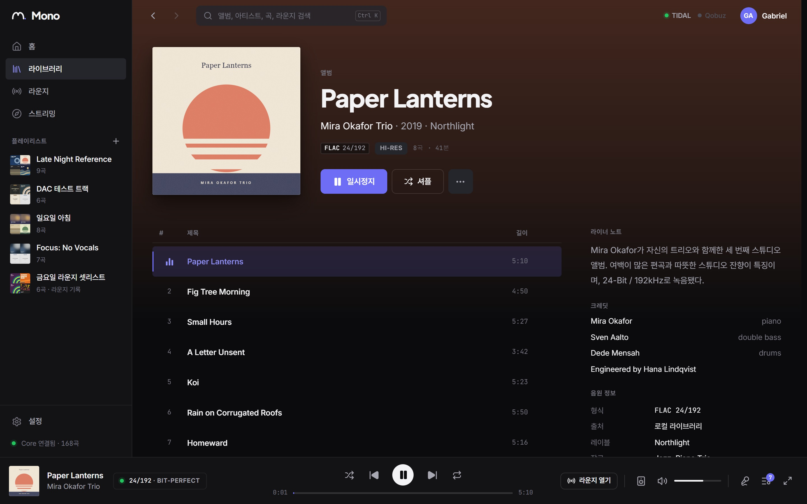
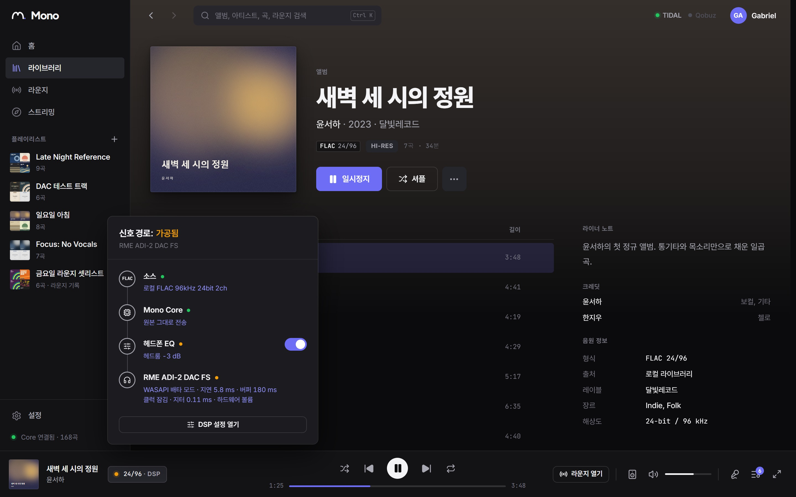
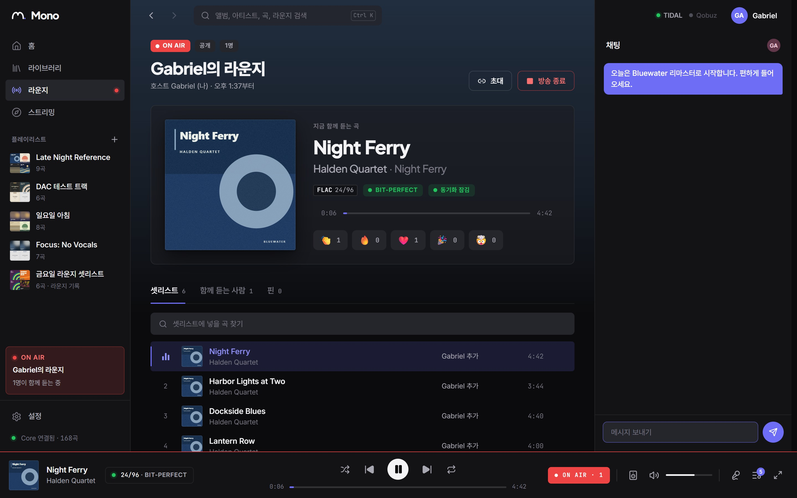
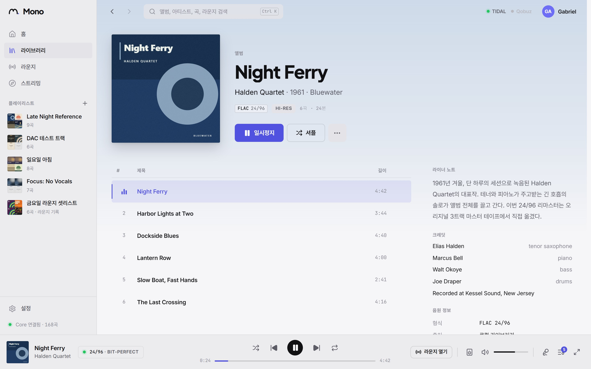
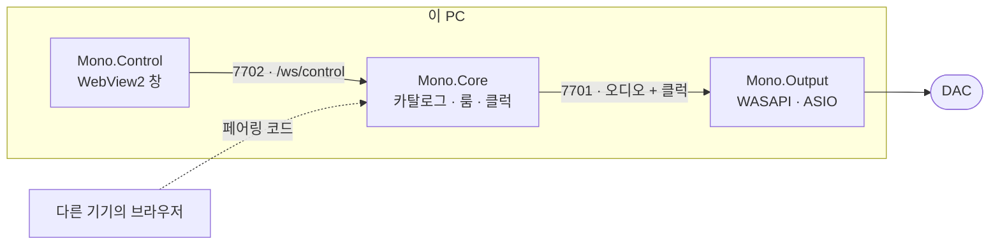

<p align="center">
  
</p>

<h1 align="center">Mono</h1>

<p align="center">
  <b>하이파이 오디오 라운지.</b><br>
  혼자 들을 때도, 같이 들을 때도 같은 소리가 납니다.
</p>

<p align="center">
  
  
  
  
</p>

<p align="center">
  <a href="#빠른-시작">빠른 시작</a> ·
  <a href="#구조">구조</a> ·
  <a href="#지금-상태">지금 상태</a> ·
  <a href="#문서">문서</a>
</p>

<p align="center">
  
</p>

<p align="center">
  <sub>새 Control 화면(<a href="redesign/"><code>redesign/</code></a>). 이식 작업 중이며, 화면의 앨범과 사용자는 모의 데이터입니다.</sub>
</p>

<br>

## 무엇을 하는가

<table>
  <tr>
    <td width="50%" valign="top">
      
      <h3>소리가 지나가는 길이 보입니다</h3>
      파일에서 DAC 까지, 어디서 무엇이 손댔는지 단계별로 보여 줍니다.
      아무것도 손대지 않았으면 초록, DSP 나 리샘플링이 끼어들면 앰버입니다.
    </td>
    <td width="50%" valign="top">
      
      <h3>듣는 데 집중하는 화면</h3>
      커버와 가사만 남깁니다. 로컬 파일과 TIDAL · Qobuz 를 한 라이브러리에서 고르고,
      같은 경로로 재생합니다.
    </td>
  </tr>
  <tr>
    <td width="50%" valign="top">
      
      <h3>라운지</h3>
      방을 열면 연결한 기기들이 같은 곡을 같은 시각에 듣습니다.
      셋리스트, 채팅, 반응이 한 화면에 있습니다.
    </td>
    <td width="50%" valign="top">
      
      <h3>두 가지 테마</h3>
      섀시는 무채색이고 색은 앨범 커버에서 나옵니다.
      규칙은 <a href="redesign/DESIGN.md"><code>redesign/DESIGN.md</code></a> 한 곳에 있습니다.
    </td>
  </tr>
</table>

| | |
| --- | --- |
| **포맷** | FLAC · WAV · AIFF · ALAC · M4A · MP3 · AAC · DSF · DFF |
| **출력** | WASAPI(공유 · 배타), ASIO, DSD(DoP) |
| **DSP** | 헤드폰 · 스피커 프리셋, 컨볼루션(Room IR). 끄면 원본 그대로 나갑니다 |
| **스트리밍** | TIDAL(OAuth), Qobuz(앱 토큰) |
| **가사 · 커버** | `.lrc` 또는 태그 내장 · 태그 또는 `cover.jpg` |

## 구조

Mono 는 세 프로세스로 나뉩니다. 무엇을 틀지 정하는 쪽과 실제로 소리를 내는 쪽이 서로 다른 프로세스입니다.



| 포트 | 용도 |
| --- | --- |
| 7700 | Control ↔ Core (TCP JSON) |
| 7701 | MATP (오디오 + 클럭) |
| 7702 | Control UI(정적) · REST · `/ws/control` · SignalR `/hub`(이 PC 만) |
| 5273 | Vite 개발 서버 (개발 중에만) |

```
src/Mono.Core      서버. 카탈로그, 룸, 재생 시계, 스트리밍 연동
src/Mono.Control   WebView2 창 + Core · Output 프로세스 관리 + 트레이 · 업데이트
src/Mono.Output    오디오 출력 워커
src/Mono.Web       Control 화면 (React). vite build → src/Mono.Core/wwwroot
src/Mono.Cli       개발용 CLI
redesign/          새 Control 화면. 이식 전
```

화면은 `/ws/control` WebSocket 으로 TCP 7700 과 같은 `MonoMessage` 규약을 씁니다.
두 전송 계층이 `ControlSession`(`src/Mono.Core/ControlPlane.cs`) 한 곳을 공유하므로 CLI 와 화면이 같은 명령을 냅니다.
TypeScript 쪽 거울은 `src/Mono.Web/src/lib/protocol.ts` 입니다.

`Mono.Control.exe` 는 화면을 띄우는 셸입니다. `window.mono` 브리지로 브라우저가 못 하는 일(폴더 선택, Output 워커 기동, 업데이트, 트레이)만 열어 줍니다.
브라우저로 `http://127.0.0.1:7702` 를 열어도 같은 화면이 뜨고, 그때는 브리지가 없어 출력 연결만 막힙니다.

## 빠른 시작

.NET SDK(9.0.200 이상, 프로젝트 타깃은 `net8.0`), Node.js, WebView2 런타임이 필요합니다. WebView2 는 Windows 11 에 기본으로 들어 있습니다.

```powershell
cd src/Mono.Web; npm install; npm run build; cd ../..
dotnet build Mono.slnx
dotnet run --project src/Mono.Control
```

Control 이 Core 를 찾아 띄우고 창을 엽니다. 소리는 설정의 **오디오 엔진 → 출력 연결**에서 Output 을 붙이면 납니다.

<details>
<summary><b>화면만 고칠 때</b></summary>

<br>

Core 를 따로 띄우고 Vite 개발 서버를 씁니다.

```powershell
dotnet run --project src/Mono.Core
cd src/Mono.Web; npm run dev          # http://localhost:5273
```

</details>

<details>
<summary><b>새 화면(<code>redesign/</code>)을 볼 때</b></summary>

<br>

Core 없이 모의 서버로 띄울 수 있습니다.

```powershell
cd redesign; npm install
npm run mock                          # 모의 Core, http://127.0.0.1:7802
npm run dev                           # http://127.0.0.1:5373
npm run capture                       # 창을 띄우지 않고 screenshots/ 에 캡처
```

실제 Core 에 붙일 때는 `$env:CORE = "http://127.0.0.1:7702"; npm run dev`.

</details>

<details>
<summary><b>CLI 로 확인할 때</b></summary>

<br>

```powershell
dotnet run --project src/Mono.Core
dotnet run --project src/Mono.Cli
dotnet run --project src/Mono.Output -- --room=<룸ID>
```

```
create audiophile Night Lounge
add tr-blue-train
play
```

Output 옵션: `--host=` `--room=` `--invite=` `--name=` `--device=` `--volume=0-100` `--shared` `--dsd`

</details>

### 테스트

```powershell
dotnet test Mono.slnx
cd src/Mono.Web; npm run typecheck
```

## 설정

Core 실행 폴더의 `appsettings.json` 에 적습니다. 아래 값은 기본값입니다(`LibraryRoot` 만 예시).

```json
{
  "Mono": {
    "LibraryRoot": "D:\\Music",
    "ScanIntervalMinutes": 30,
    "ControlUrl": "http://127.0.0.1:7702",
    "AllowedHosts": ""
  }
}
```

| 키 | 뜻 |
| --- | --- |
| `LibraryRoot` | 로컬 음원 폴더. 없으면 Core 의 `data/library`. 여러 곳이면 `LibraryRoots` 배열을 씁니다 |
| `ScanIntervalMinutes` | 라이브러리를 다시 훑는 간격 |
| `ControlUrl` | 7702 를 여는 주소. 다른 기기에서 붙으려면 `http://0.0.0.0:7702` |
| `AllowedHosts` | 이름(도메인)으로 Core 에 접속할 때 그 이름을 쉼표로 적습니다. IP 주소와 `localhost` 는 적지 않아도 됩니다 |

## 접속과 보안

Core 에는 로그인이 없습니다. 누가 말을 거는지는 요청과 연결에서 가려냅니다.

- **이 PC** 에서 온 연결이 주인입니다.
- **다른 기기**는 Core 가 발급한 6자리 페어링 코드로 붙습니다. 원격 연결은 라이브러리 스캔, 백업, 스트리밍 계정 연결을 할 수 없습니다.
- **다른 사이트의 웹 페이지**는 Core 에 붙지 못합니다. Origin 과 Host 를 확인합니다.
- **REST** 는 이 PC 에서 온 요청만 받습니다. 커버(`/api/art`), 상태 확인(`/api/health`), 스트림 프록시는 예외입니다.

> [!WARNING]
> 7700 과 7701 은 아직 모든 네트워크 인터페이스에 열리고, 7701 에는 인증이 없습니다. 믿을 수 있는 네트워크에서만 쓰세요.
> 남은 문제와 해결안은 [`docs/07-백엔드-점검.md`](docs/07-백엔드-점검.md) 에 있습니다.

<details>
<summary><b>REST API</b></summary>

<br>

| 경로 | 내용 |
| --- | --- |
| `GET /api/health` | 룸 · 트랙 · 엔드포인트 |
| `GET /api/catalog` | 카탈로그 |
| `GET /api/art/{trackId}` | 앨범 아트 |
| `GET /api/reactions/{trackId}` | 반응 히트맵 |
| `GET /api/wiki/{artistId}` | 위키 요약 |
| `GET /api/endpoints` | 등록된 출력 엔드포인트 |
| `WS /ws/control` | 컨트롤 플레인 (`MonoMessage`) |

</details>

## 지금 상태

2026-11-16 기준입니다. 이어서 할 일과 순서는 [`redesign/HANDOFF.md`](redesign/HANDOFF.md) 에 있습니다.

| 항목 | 상태 |
| --- | --- |
| 출시 버전 | 0.5.9.3. 화면은 `src/Mono.Web` ([변경 내역](CHANGELOG.md)) |
| 새 Control 화면 | `redesign/` 에 있습니다. 모의 Core 로만 확인했고 `src/Mono.Web` 에는 아직 이식하지 않았습니다 |
| Core 접속 강화 | 코드에 반영했습니다. 빌드는 통과했고 테스트는 아직 돌리지 못했습니다 |
| 남은 과제 | 계정 체계, 7701 인증, 토큰 저장, 릴리스 서명, 곡 id 체계, .NET 10 |
| 출시 전에 풀 것 | 라운지의 음원 공유 범위, 라이선스 고지, 밝은 테마의 글자 대비 |

## 릴리스

버전은 `Directory.Build.props` 한 곳에만 둡니다. 릴리스 노트는 [`CHANGELOG.md`](CHANGELOG.md) 의 같은 버전 절이 그대로 나갑니다.

```powershell
git tag v<버전>; git push origin v<버전>     # Actions 의 release 워크플로가 빌드해서 올립니다
```

로컬에서 만들 때는 `publish.ps1` 을 씁니다. React 번들을 먼저 빌드한 뒤 publish 합니다.
산출물은 `Mono.Control.exe` + `Mono.Core.exe` + `Mono.Output.exe` + `wwwroot/` 가 한 폴더에 놓이는 구성입니다.

## 문서

| 문서 | 내용 |
| --- | --- |
| [`docs/01-기획명세서.md`](docs/01-기획명세서.md) | 기획 |
| [`docs/02-아키텍처.md`](docs/02-아키텍처.md) | 아키텍처 |
| [`docs/03-구현현황.md`](docs/03-구현현황.md) | 구현 현황 |
| [`docs/04-UIUX기획서.md`](docs/04-UIUX기획서.md) | UI/UX, 배포 규약 |
| [`docs/05-아이콘디자인스펙.md`](docs/05-아이콘디자인스펙.md) | 아이콘 |
| [`docs/06-로드맵.md`](docs/06-로드맵.md) | v1.0 까지의 로드맵 |
| [`docs/07-백엔드-점검.md`](docs/07-백엔드-점검.md) | Core 점검: 고친 것, 남은 것 |
| [`redesign/DESIGN.md`](redesign/DESIGN.md) | 새 화면의 디자인 규칙 |
| [`redesign/HANDOFF.md`](redesign/HANDOFF.md) | 이어서 할 일 |

이전 Avalonia UI 는 `legacy/Mono.Control.Avalonia` 에 보관돼 있습니다(빌드 대상 아님).

## 서드파티

새 화면이 번들에 싣는 글꼴과 아이콘입니다.

| | 라이선스 |
| --- | --- |
| Plus Jakarta Sans · Inter · JetBrains Mono · Wanted Sans · Pretendard | SIL Open Font License 1.1 |
| Lucide | ISC |

TIDAL, Qobuz, Discord 는 각 소유자의 상표입니다.
