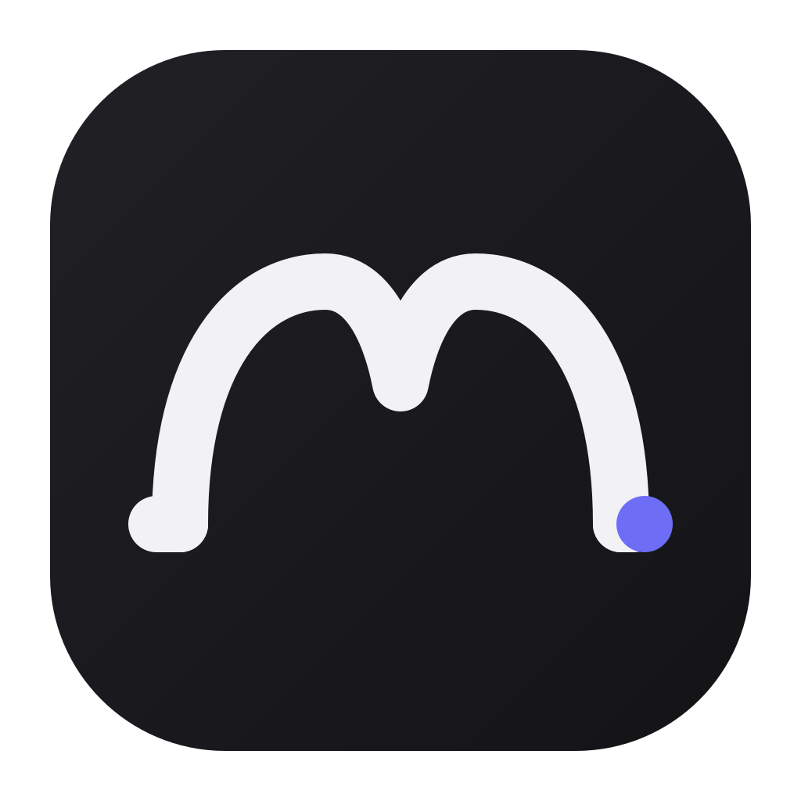
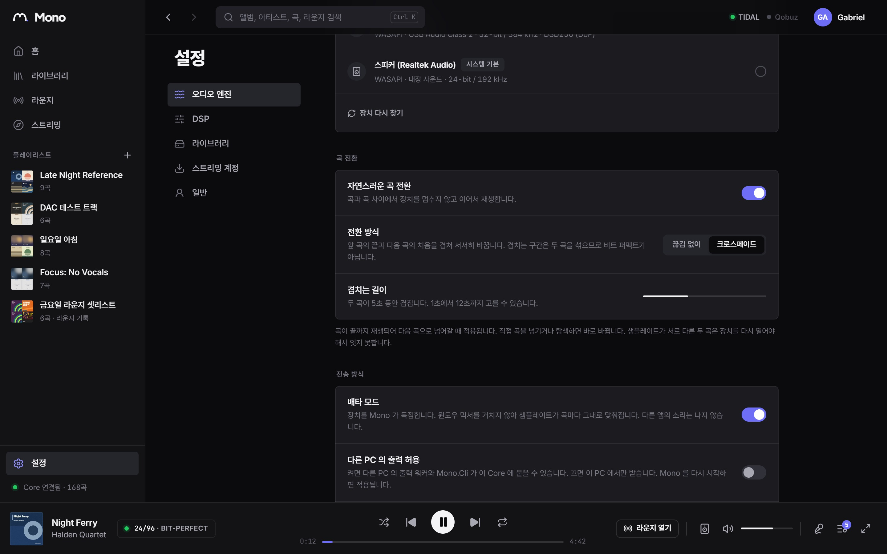
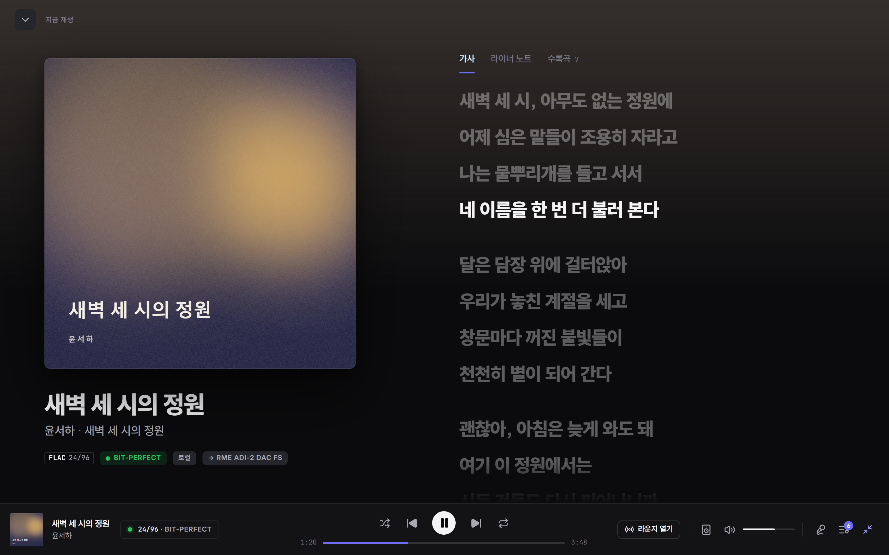
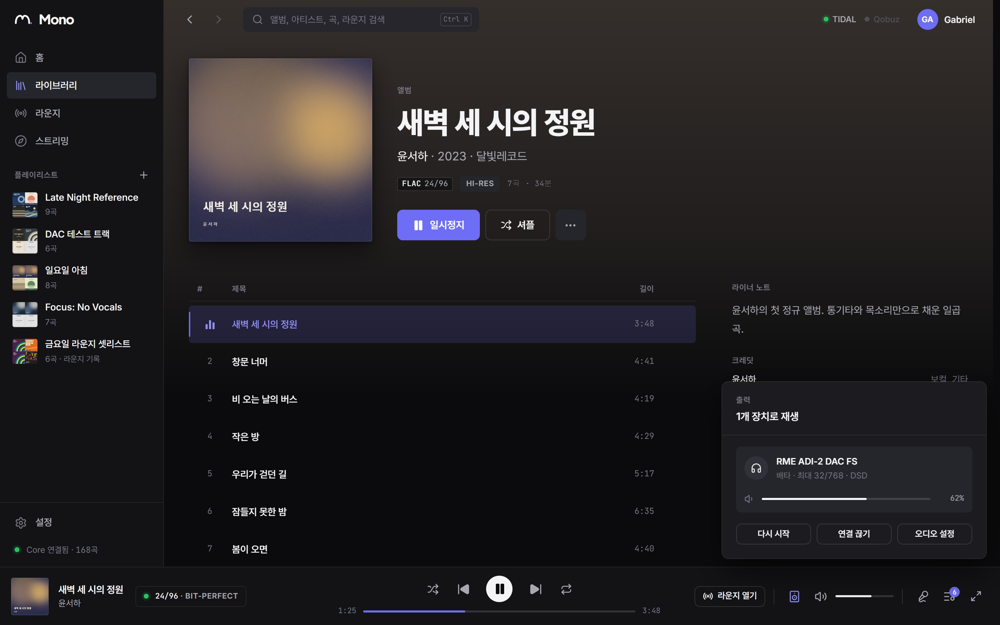
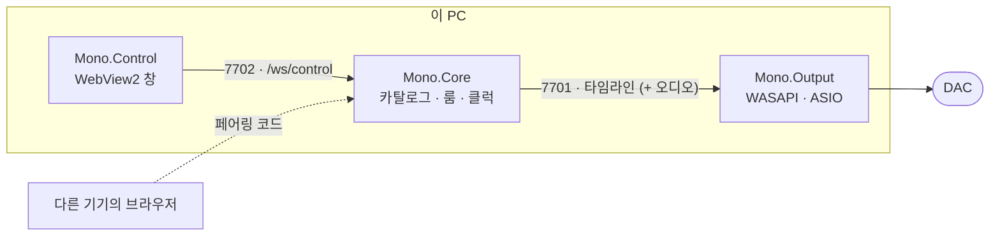

<p align="center">
  
</p>

<h1 align="center">Mono</h1>

<p align="center">
  <b>하이파이 오디오 라운지.</b><br>
  혼자 들을 때도, 같이 들을 때도 같은 소리가 납니다.
</p>

<p align="center">
  <a href="CHANGELOG.md"></a>
  
  
  
  
</p>

<p align="center">
  <a href="#무엇을-하는가">기능</a> ·
  <a href="#소리를-다루는-방식">소리</a> ·
  <a href="#구조">구조</a> ·
  <a href="#빠른-시작">빠른 시작</a> ·
  <a href="#지금-상태">지금 상태</a> ·
  <a href="#문서">문서</a>
</p>

<p align="center">
  
</p>

<p align="center">
  <sub>Control 화면(<a href="src/Mono.Web/"><code>src/Mono.Web</code></a>). 캡처의 앨범과 사용자는 모의 데이터입니다.</sub>
</p>

<br>

## 무엇을 하는가

<table>
  <tr>
    <td width="50%" valign="top">
      
      <h3>소리가 지나가는 길이 보입니다</h3>
      파일에서 DAC 까지, 어디서 무엇이 손댔는지 단계별로 보여 줍니다.
      아무것도 손대지 않았으면 초록, DSP 나 업샘플링이 끼어들면 앰버입니다.
      화면은 실제로 한 일만 말합니다.
    </td>
    <td width="50%" valign="top">
      
      <h3>곡과 곡 사이가 끊기지 않습니다</h3>
      라이브 앨범과 악장이 이어지는 음반은 틈 없이 이어 붙이고,
      플레이리스트는 1초에서 12초까지 겹쳐서 넘깁니다. 끄면 예전처럼 한 곡씩 끊어 재생합니다.
    </td>
  </tr>
  <tr>
    <td width="50%" valign="top">
      
      <h3>듣는 데 집중하는 화면</h3>
      커버와 가사만 남깁니다. 로컬 파일과 TIDAL · Qobuz 를 한 라이브러리에서 고르고,
      같은 경로로 재생합니다.
    </td>
    <td width="50%" valign="top">
      
      <h3>라운지</h3>
      방을 열면 연결한 기기들이 같은 곡을 같은 시각에 듣습니다.
      셋리스트, 채팅, 반응이 한 화면에 있습니다.
    </td>
  </tr>
  <tr>
    <td width="50%" valign="top">
      
      <h3>장치를 직접 고릅니다</h3>
      WASAPI 배타 · 공유와 ASIO 를 지원합니다. 출력이 여러 쌍인 인터페이스에서는
      어느 쌍으로 낼지도 고릅니다. 헤드폰 단자가 3/4 에 있다면 그쪽으로 보냅니다.
    </td>
    <td width="50%" valign="top">
      
      <h3>두 가지 테마</h3>
      섀시는 무채색이고 색은 앨범 커버에서 나옵니다.
      규칙은 <a href="src/Mono.Web/DESIGN.md"><code>src/Mono.Web/DESIGN.md</code></a> 한 곳에 있습니다.
    </td>
  </tr>
</table>

| | |
| --- | --- |
| **포맷** | FLAC · WAV · AIFF · ALAC · M4A · MP3 · AAC. DSF · DFF 는 라이브러리에는 들어오지만 아직 재생하지 않습니다 |
| **출력** | WASAPI(배타 · 공유), ASIO(출력 쌍 선택) |
| **곡 전환** | 끊김 없이(갭리스) · 크로스페이드 1~12초 · 끔 |
| **DSP** | 헤드폰 EQ · 스피커 보정 · 룸 보정(컨볼루션) · 크로스피드 · 파라메트릭 EQ. 끄면 원본 그대로 나갑니다 |
| **스트리밍** | TIDAL(OAuth), Qobuz(앱 토큰) |
| **가사 · 커버** | `.lrc` 또는 태그 내장 · 태그 또는 `cover.jpg` |

## 소리를 다루는 방식

원칙은 하나입니다. **손대지 않은 샘플은 그대로 내보내고, 손댔으면 손댔다고 말한다.**

<table>
  <tr>
    <td width="33%" valign="top">
      <h4>그대로 내보내기</h4>
      디코더가 낸 정수 PCM 을 그대로 장치에 넘깁니다. 16bit 원본은 하위 바이트를 0 으로 채워 24bit 로 넓힐 뿐이고,
      float 를 거치는 구간에서도 같은 눈금으로 되돌려 한 비트도 달라지지 않습니다.
    </td>
    <td width="33%" valign="top">
      <h4>끊김 없이 잇기</h4>
      출력 워커가 다음 곡을 미리 열어 두고, 디코더가 실제로 끝에 닿는 자리에서 다음 곡의 첫 샘플을 붙입니다.
      장치를 멈추지 않으므로 곡 사이에 무음도, 잘리는 꼬리도 없습니다.
    </td>
    <td width="33%" valign="top">
      <h4>크로스페이드</h4>
      두 곡을 등전력(cos/sin) 곡선으로 겹칩니다. 직선으로 섞으면 가운데에서 소리가 꺼지기 때문입니다.
      계산을 거치는 건 겹치는 구간뿐이고, 그 앞뒤는 원본 바이트입니다.
    </td>
  </tr>
  <tr>
    <td width="33%" valign="top">
      <h4>끊는 자리</h4>
      일시정지 · 탐색 · 곡 넘기기는 파형을 아무 데서나 자릅니다.
      끊기 직전 8ms 동안 내리고 곡 중간에서 다시 시작할 때 8ms 동안 올려 딸깍 소리를 없앱니다.
      곡의 첫 음에는 걸지 않습니다.
    </td>
    <td width="33%" valign="top">
      <h4>볼륨과 디더</h4>
      ASIO 에서는 float 단계에서 줄여 하위 비트를 잃지 않습니다. 정수로 되돌려야 하는 곳에서는
      TPDF 디더를 걸어 양자화 왜곡을 고른 잡음으로 바꿉니다. 볼륨을 움직이는 동안은 프레임 단위로 이어 줍니다.
    </td>
    <td width="33%" valign="top">
      <h4>DSP</h4>
      필터의 상태를 조각 사이에 이어 가므로 EQ 를 켜도 조각 경계에서 파형이 꺾이지 않습니다.
      2배 업샘플링은 95탭 하프밴드 FIR 로 하고, 장치가 그 레이트를 받을 때만 합니다.
    </td>
  </tr>
</table>

플레이어 바의 `BIT-PERFECT` 칩은 다음이 모두 참일 때만 켜집니다. DSP 와 업샘플링이 꺼져 있고, 장치가 곡의 규격을 그대로 받으며, 배타로 붙어 있고, 하드웨어 볼륨이 없는 장치라면 볼륨이 100% 일 것.

> [!NOTE]
> 곡 전환, 페이드, 디더, 출력 워커의 DSP 는 0.6.0 이후에 `development` 에 들어온 변경입니다.
> 아직 릴리스 전이고, 실제 장치에서의 청취 확인과 새 테스트 실행이 남아 있습니다.
> 확인할 목록은 [`docs/handoff1117.md`](docs/handoff1117.md) 에 있습니다.

아직 하지 않는 것도 적어 둡니다.

- 곡을 잇는 건 출력 워커가 파일을 직접 여는 방(혼자 듣기, 클럭 동기 라운지)에서만 합니다. Core 가 오디오를 보내 주는 방에서는 곡이 바뀔 때 끊고 새로 시작합니다.
- 샘플레이트나 비트 뎁스가 다른 두 곡은 잇지 않습니다. 앞 곡을 끝까지 낸 뒤 장치를 다시 열고 다음 곡을 처음부터 시작합니다.
- 장치가 받지 못하는 규격을 맞춰 주는 리샘플러는 없습니다. 그 경우 화면은 변환했다고 하지 않고 받지 못한다고 알립니다.
- MP3 · AAC 의 인코더 지연과 패딩은 보정하지 않습니다. ReplayGain 과 DSD 재생도 아직 없습니다.

## 구조

Mono 는 세 프로세스로 나뉩니다. 무엇을 틀지 정하는 쪽과 실제로 소리를 내는 쪽이 서로 다른 프로세스입니다.



소리가 나가는 길은 방의 종류에 따라 둘 중 하나입니다.

| 경로 | 쓰는 곳 | 누가 디코드하는가 |
| --- | --- | --- |
| **클럭싱크** | 혼자 듣기, 듣던 방을 공개로 연 라운지 | 출력 워커가 파일을 직접 열고, Core 는 타임라인만 방송합니다. 곡 전환과 출력 쪽 DSP 가 여기서 일어납니다 |
| **팬아웃** | 처음부터 공개 라운지 · 호스트 큐로 만든 방 | Core 가 디코드해 20ms 조각으로 출력에 보냅니다 |

| 포트 | 용도 |
| --- | --- |
| 7700 | Control ↔ Core (TCP JSON) |
| 7701 | MATP (타임라인 · 클럭, 팬아웃에서는 오디오) |
| 7702 | Control UI(정적) · REST · `/ws/control` · SignalR `/hub`(이 PC 만) |
| 5273 | Vite 개발 서버 (개발 중에만) |

```
src/Mono.Core      서버. 카탈로그, 룸, 재생 시계, 스트리밍 연동
src/Mono.Control   WebView2 창 + Core · Output 프로세스 관리 + 트레이 · 업데이트
src/Mono.Output    오디오 출력 워커. 장치, 곡 전환, 페이드, 볼륨
src/Mono.Shared    두 쪽이 같이 쓰는 모델과 신호 수학(PCM 변환, 디더, DSP 체인)
src/Mono.Protocol  메시지 규약
src/Mono.Web       Control 화면 (React). vite build → src/Mono.Core/wwwroot
src/Mono.Setup     설치 프로그램
src/Mono.Cli       개발용 CLI
```

화면은 `/ws/control` WebSocket 으로 TCP 7700 과 같은 `MonoMessage` 규약을 씁니다.
두 전송 계층이 `ControlSession`(`src/Mono.Core/ControlPlane.cs`) 한 곳을 공유하므로 CLI 와 화면이 같은 명령을 냅니다.
TypeScript 쪽 거울은 `src/Mono.Web/src/lib/protocol.ts` 입니다.

`Mono.Control.exe` 는 화면을 띄우는 셸입니다. `window.mono` 브리지로 브라우저가 못 하는 일(폴더 선택, Output 워커 기동, 업데이트, 트레이)만 열어 줍니다.
브라우저로 `http://127.0.0.1:7702` 를 열어도 같은 화면이 뜨고, 그때는 브리지가 없어 출력 연결만 막힙니다.

## 빠른 시작

.NET SDK(9.0.200 이상, 프로젝트 타깃은 `net8.0`), Node.js, WebView2 런타임이 필요합니다. WebView2 는 Windows 11 에 기본으로 들어 있습니다.

```powershell
cd src/Mono.Web; npm install; npm run build; cd ../..
dotnet build Mono.slnx
dotnet run --project src/Mono.Control
```

Control 이 Core 를 찾아 띄우고 창을 엽니다. 소리는 설정의 **오디오 엔진**에서 출력 장치를 고르면 납니다.

<details>
<summary><b>화면만 고칠 때</b></summary>

<br>

Core 를 따로 띄우고 Vite 개발 서버를 씁니다.

```powershell
dotnet run --project src/Mono.Core
cd src/Mono.Web; npm run dev          # http://localhost:5273
```

</details>

<details>
<summary><b>Core 없이 화면만 볼 때</b></summary>

<br>

모의 서버로 띄울 수 있습니다.

```powershell
cd src/Mono.Web; npm install
npm run mock                                         # 모의 Core, http://127.0.0.1:7802
$env:CORE = "http://127.0.0.1:7802"; npm run dev     # http://localhost:5273
npm run capture                                      # 창을 띄우지 않고 screenshots/ 에 캡처
```

이 문서의 캡처도 그렇게 만들었습니다(`SCALE=2 FORMAT=jpg`). 자세한 것은 [`src/Mono.Web/README.md`](src/Mono.Web/README.md).

</details>

<details>
<summary><b>CLI 로 확인할 때</b></summary>

<br>

```powershell
dotnet run --project src/Mono.Core
dotnet run --project src/Mono.Cli
dotnet run --project src/Mono.Output -- --room=<룸ID>
```

```
create invite Night Lounge
add tr-blue-train
play
transition crossfade 8
```

`create` 는 `open` · `invite` · `host` · `audiophile` 을 받습니다. 곡 전환은 클럭싱크 방(`invite` · `audiophile`)에서 적용됩니다.

Output 옵션:

| 옵션 | 뜻 |
| --- | --- |
| `--host=` `--room=` `--invite=` `--name=` | 붙을 Core 와 방, 표시 이름 |
| `--device=` | 장치 이름의 일부. 없으면 시스템 기본 장치 |
| `--asio` `--asio-channel=N` | ASIO 로 열기, 소리를 낼 첫 출력 채널(0부터) |
| `--shared` `--strict-exclusive` | WASAPI 공유 모드로 열기, 배타가 거절돼도 공유로 내려가지 않기 |
| `--volume=0-100` | 시작 볼륨 |
| `--list-devices` `--list-asio-channels=<드라이버>` | 장치 목록, ASIO 출력 채널 이름을 찍고 끝냅니다 |

</details>

### 테스트

```powershell
dotnet test Mono.slnx
cd src/Mono.Web; npm run typecheck
```

## 설정

Core 실행 폴더의 `appsettings.json` 에 적습니다. 아래 값은 기본값입니다(`LibraryRoot` 만 예시).

```json
{
  "Mono": {
    "LibraryRoot": "D:\\Music",
    "ScanIntervalMinutes": 30,
    "ControlUrl": "http://127.0.0.1:7702",
    "AllowedHosts": ""
  }
}
```

| 키 | 뜻 |
| --- | --- |
| `LibraryRoot` | 로컬 음원 폴더. 없으면 Core 의 `data/library`. 여러 곳이면 `LibraryRoots` 배열을 씁니다 |
| `ScanIntervalMinutes` | 라이브러리를 다시 훑는 간격 |
| `ControlUrl` | 7702 를 여는 주소. 다른 기기에서 붙으려면 `http://0.0.0.0:7702` |
| `AllowedHosts` | 이름(도메인)으로 Core 에 접속할 때 그 이름을 쉼표로 적습니다. IP 주소와 `localhost` 는 적지 않아도 됩니다 |
| `AllowRemoteOutputs` | 7700 · 7701 을 LAN 에 열지. 기본은 닫힘. 화면의 "다른 PC 의 출력 허용"과 같은 값입니다 |

출력 장치, 곡 전환 같은 이 PC 의 취향은 화면의 설정에서 고르고, Core 의 `data/setup.json` 에 저장됩니다.

## 접속과 보안

Core 에는 로그인이 없습니다. 누가 말을 거는지는 요청과 연결에서 가려냅니다.

- **이 PC** 에서 온 연결이 주인입니다.
- **다른 기기**는 Core 가 발급한 6자리 페어링 코드로 붙습니다. 원격 연결은 라이브러리 스캔, 백업, 스트리밍 계정 연결을 할 수 없습니다.
- **다른 사이트의 웹 페이지**는 Core 에 붙지 못합니다. Origin 과 Host 를 확인합니다.
- **REST** 는 이 PC 에서 온 요청만 받습니다. 커버(`/api/art`), 상태 확인(`/api/health`), 스트림 프록시는 예외입니다.
- **7700 · 7701** 은 기본으로 이 PC 에서만 열립니다.

> [!WARNING]
> "다른 PC 의 출력 허용"을 켜면 7700 과 7701 이 LAN 에 열립니다. 7701 에는 인증이 없으므로 믿을 수 있는 네트워크에서만 켜세요.
> 남은 문제와 해결안은 [`docs/07-백엔드-점검.md`](docs/07-백엔드-점검.md) 에 있습니다.

<details>
<summary><b>REST API</b></summary>

<br>

| 경로 | 내용 |
| --- | --- |
| `GET /api/health` | 룸 · 트랙 · 엔드포인트 |
| `GET /api/catalog` | 카탈로그 |
| `GET /api/art/{trackId}` | 앨범 아트 |
| `GET /api/reactions/{trackId}` | 반응 히트맵 |
| `GET /api/wiki/{artistId}` | 위키 요약 |
| `GET /api/endpoints` | 등록된 출력 엔드포인트 |
| `WS /ws/control` | 컨트롤 플레인 (`MonoMessage`) |

</details>

## 지금 상태

2026-11-17 기준입니다.

| 항목 | 상태 |
| --- | --- |
| 출시 버전 | **0.6.0** ([변경 내역](CHANGELOG.md)). 새 화면, Core 접속 강화, 릴리스 당시 자동화 테스트 327개 통과 |
| 그 뒤 `development` | 탐색할 때 소리가 끊기던 문제와 대기열에서 곡을 빼다 다른 곡이 재생되던 문제를 고쳤습니다. 재생 엔진을 다시 썼습니다(위 [소리를 다루는 방식](#소리를-다루는-방식)). 아직 릴리스하지 않았습니다 |
| 검증이 남은 것 | 재생 엔진 변경은 빌드와 화면 동작까지만 확인했습니다. 새로 쓴 테스트의 실행과 실제 장치(ASIO)에서의 청취가 남아 있습니다. 순서와 체크리스트는 [`docs/handoff1117.md`](docs/handoff1117.md) |
| 남은 과제 | 장치 규격에 맞추는 리샘플링, 팬아웃 경로의 곡 전환, DSD 재생, 계정 체계, 7701 인증(원격 출력 페어링), 릴리스 서명, .NET 10 |
| 출시 전에 풀 것 | 라운지의 음원 공유 범위, 라이선스 고지, 밝은 테마의 글자 대비 |

## 릴리스

버전은 `Directory.Build.props` 한 곳에만 둡니다. 릴리스 노트는 [`CHANGELOG.md`](CHANGELOG.md) 의 같은 버전 절이 그대로 나갑니다.

```powershell
git tag v<버전>; git push origin v<버전>     # Actions 의 release 워크플로가 빌드해서 올립니다
```

로컬에서 만들 때는 `publish.ps1` 을 씁니다. React 번들을 먼저 빌드한 뒤 publish 합니다.
산출물은 `Mono.Control.exe` + `Mono.Core.exe` + `Mono.Output.exe` + `wwwroot/` 가 한 폴더에 놓이는 구성입니다.

## 문서

| 문서 | 내용 |
| --- | --- |
| [`docs/01-기획명세서.md`](docs/01-기획명세서.md) | 기획 |
| [`docs/02-아키텍처.md`](docs/02-아키텍처.md) | 아키텍처 |
| [`docs/03-구현현황.md`](docs/03-구현현황.md) | 구현 현황 |
| [`docs/04-UIUX기획서.md`](docs/04-UIUX기획서.md) | UI/UX, 배포 규약 |
| [`docs/05-아이콘디자인스펙.md`](docs/05-아이콘디자인스펙.md) | 아이콘 |
| [`docs/06-로드맵.md`](docs/06-로드맵.md) | v1.0 까지의 로드맵 |
| [`docs/07-백엔드-점검.md`](docs/07-백엔드-점검.md) | Core 점검: 고친 것, 남은 것 |
| [`docs/08-인수인계.md`](docs/08-인수인계.md) | 화면 리디자인과 Core 강화의 인수인계 |
| [`docs/handoff1117.md`](docs/handoff1117.md) | 재생 엔진의 인수인계: 바뀐 것, 확인할 것, 남은 것 |
| [`src/Mono.Web/DESIGN.md`](src/Mono.Web/DESIGN.md) | 화면의 디자인 규칙 |
| [`src/Mono.Web/README.md`](src/Mono.Web/README.md) | 화면 실행 · 모의 Core · 캡처 |

이전 Avalonia UI 는 `legacy/Mono.Control.Avalonia` 에 보관돼 있습니다(빌드 대상 아님).

## 서드파티

화면이 번들에 싣는 글꼴과 아이콘입니다.

| | 라이선스 |
| --- | --- |
| Plus Jakarta Sans · Inter · JetBrains Mono · Wanted Sans · Pretendard | SIL Open Font License 1.1 |
| Lucide | ISC |

TIDAL, Qobuz, Discord 는 각 소유자의 상표입니다.
